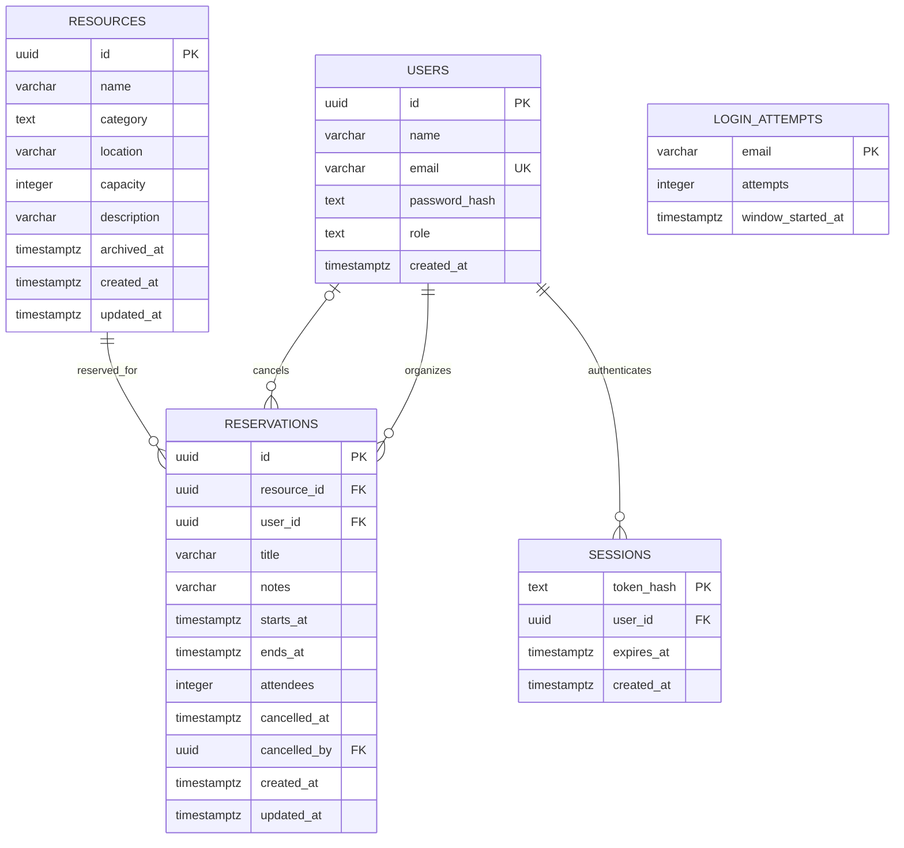

# Database relationships

Every reservation has one resource and one organizer. A cancelled reservation also records the user who cancelled it. Resources and reservation history are retained, rather than deleted. Login attempts are keyed by the submitted email address, including addresses without an account, so this table deliberately has no user foreign key. `schema_migrations` is operational migration bookkeeping, not part of the business model.

Active resource names are unique without regard to case. PostgreSQL's `reservations_no_overlap` exclusion constraint compares the resource ID and the half-open `[start, end)` time range of non-cancelled reservations. Adjacent reservations are allowed; overlapping reservations for the same resource are rejected, including concurrent inserts.

The diagram can be shared using this file's GitHub page once these changes are pushed. GitHub renders the Mermaid diagram directly. A standalone [SVG version](er-diagram.svg) is also included.
